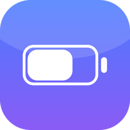
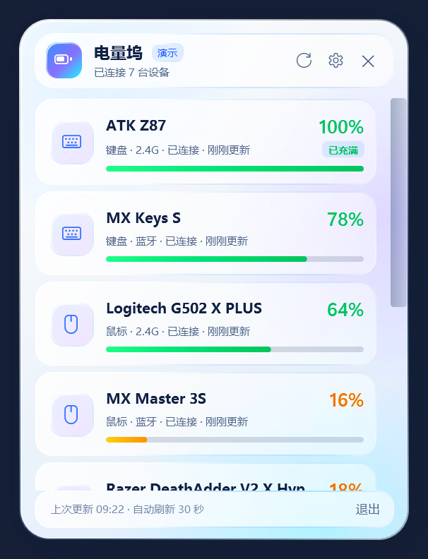

# 电量坞（BatteryDock）

<p align="center">
  
</p>

<p align="center">
  <strong>一个安静的 Windows 托盘小工具，随时查看蓝牙和 2.4G 外设电量。</strong>
</p>

<p align="center">
  
  
  
  <a href="https://github.com/703488625/battery-dock/actions/workflows/ci.yml">
    
  </a>
  <a href="https://github.com/703488625/battery-dock/releases">
    
  </a>
</p>

> A local-only Windows tray app for Bluetooth and 2.4 GHz peripheral battery levels. No vendor software, no network, no telemetry.

点开任务栏隐藏图标就能看电量。界面采用液态玻璃风格：半透明玻璃壳、柔和的环境光场、渐变边缘高光和内外阴影。设置 → 外观 → 主题可以切换“跟随系统 / 浅色 / 深色”，玻璃材质会同步适配。

> **下载**：从 [GitHub Releases](https://github.com/703488625/battery-dock/releases/latest) 下载 `BatteryDock-v1.0.0-win-x64.zip`，解压后运行 `BatteryDock.exe`。  
> 这是自包含单文件程序，不需要安装 .NET；第一次运行可能遇到 SmartScreen，选择“更多信息 → 仍要运行”。



## 目录

- [它能做什么](#它能做什么)
- [支持范围](#支持范围)
- [使用](#使用)
- [命令行参数](#命令行参数)
- [数据位置](#数据位置)
- [从源码构建](#从源码构建)
- [排障](#排障)
- [更多文档](#更多文档)
- [许可与致谢](#许可与致谢)

## 它能做什么

- **蓝牙 + 2.4G 一起显示**：蓝牙外设和 USB 接收器外设放在同一个简洁面板里。
- **托盘常驻**：不占任务栏，点击隐藏图标里的电池图标打开面板。
- **自适应刷新**：面板打开时按设定频率刷新；面板关闭后自动降到至少 2 分钟一次，减少后台占用，最长不超过 10 分钟。
- **充电状态**：支持读取充电/充满标志的设备会在卡片上显示“充电中 / 已充满”，托盘图标也会变为绿色。
- **稳定设备 ID / 热插拔**：罗技接收器优先用设备序列号或 unit ID 识别设备，换 USB 口、换接收器槽位后仍能沿用上次电量；监听接收器 `0x41` 到达/离开通知，设备开关机或接收器插拔后立即刷新。
- **低电量提醒 + 免打扰**：低于阈值时发一次 Windows 通知；正在充电的设备不会重复提示；可设置免打扰时段，时段内静默，结束后补发。
- **设备工具**：键盘按键测试、雷蛇/罗技鼠标 DPI 与回报率设置。
- **液态玻璃 + 深浅色主题**：半透明玻璃卡片、环境光场与渐变高光；跟随系统，或手动选择浅色 / 深色。
- **开机启动**：在设置里一键开启，写入当前用户启动项，不需要管理员权限。
- **记住上次电量**：设备休眠或暂时断开时，显示上次成功读到的电量；刷新时原地更新设备卡片，不会先清空面板闪出空页面。
- **单实例**：重复打开只会唤出已经运行的面板，不会多开。
- **数据只在本机**：不联网、不上传。

## 支持范围

### 蓝牙

- 标准 BLE Battery Service（GATT 0x180F / 0x2A19）的键盘、鼠标、手柄等。
- Windows 自己提供的设备电量属性（部分设备）。
- 经典蓝牙 HFP 电量属性（部分耳机、外设）。

### 2.4G USB 接收器

2.4G 没有统一电量标准，每家厂商使用自己的 HID 协议。本版本内置了以下协议：

| 设备 | 状态 |
|---|---|
| 雷蛇（Razer）无线鼠标 / 键盘（90 字节 feature report，OpenRazer 协议） | 已实测 DeathAdder V2 X HyperSpeed |
| ATK Z87（Evision Report 4 / 命令 0x1A，非零 16 位序号） | 已在本机 Z87 实测能读到真实电量（79%），保留旧 0x87 协议回退 |
| ATK V75X（`320F:5088`，同一 Evision 协议） | 按 FerrisPulse 的 V75X 协议实现，未在 V75X 实机验证 |
| 罗技（Logitech）HID++ 2.0 无线设备（Unifying / Lightspeed / Bolt 接收器，及部分直连） | 已实测 G PRO X SUPERLIGHT（接收器 `046D:C547`）的 HID++ 2.0 电量读取；其他型号未逐一验证 |
| 华硕 ROG Omni 接收器（`0B05:1ACE`，Report 0x03，命令 `12 07`） | 按 BatteryViewer / FerrisPulse 的协议实现；本机无 ROG 设备，未实机验证 |
| MCHOSE L7 / M7 / A7 / K7 / A5 / AX5 等 2.4G 鼠标（`0x5253` / `0x3837`，Report `0x11` / 命令 `0x06`） | 按 mchose-linux 协议实现；本机无 MCHOSE 鼠标，未实机验证；G3 系列不支持 |
| ATK / VXE / VGN 无线鼠标（COMPX / HECHI / Nordic 52 / 54） | COMPX 与 Nordic 已实现；HECHI 按 atktool 实现，未逐一实机验证 |
| 其他厂商私有 2.4G 协议 | 暂不支持，界面会显示“暂未提供电量”或不显示 |

> **关于 ATK Z87**：旧版只使用 `04 87 ...` 查询，键盘休眠时该命令返回 `0x00`，会被误读成 0%。新版优先使用 Evision `04 SeqLo SeqHi 1A` 查询，并要求回包序号、命令都匹配；本机实测返回 79%。旧协议的 `0x00` 现在按“休眠/无读数”处理，并回退到上次电量。
>
> **关于 ATK / VXE 鼠标**：2.4G 私有协议因型号而异。本版会依次尝试 COMPX、HECHI 以及常见 Nordic 52/54 帧；如果某型号仍读不到，通常是它使用了尚未适配的私有协议，而不是接收器损坏。
>
> **关于罗技**：直接走 HID++ 2.0，不需要 G HUB / Options+。接收器会按设备槽分别查询，电量按信息量依次尝试：`0x1004` 统一电量（先读 capabilities 判断是否直报百分比）→ `0x1000` 电量状态 → `0x0104` Centurion → `0x1001` 电压曲线 → `0x1F20` ADC。设备名来自 `0x0005`；设备身份来自 `0x0003`，优先使用序列号，其次使用 unit ID + model ID，因此换 USB 口或接收器槽位后仍能对上次电量。接收器会监听 `0x41` 到达/离开通知，并主动触发一次设备上报；设备开关机或接收器插拔后会立即刷新。只有档位或电压时百分比是推算值，界面会显示 `≈`。本机已用 G PRO X SUPERLIGHT（接收器 `046D:C547`）验证 `0x1004` 能读到 56%。注意：这只鼠标的 HID++ 名称是 “PRO X Wireless”，旧版会把它误判成耳机并打开不了鼠标设置；现在按接收器 PID 识别为鼠标，卡片显示 “G PRO X SUPERLIGHT”。稳定 ID 和 `0x41` 热插拔路径已接入；本次复测时罗技接收器不在位，尚未完成这两项的实机确认。其他罗技型号仍建议带上设备型号和 `--verbose` 日志反馈。
>
> **关于 ROG Omni**：接收器 `0B05:1ACE` 使用 Report `0x03`、命令 `12 07`，电量在回包 byte[5]、充电在 byte[10]；有线形态使用 `00` 占位前缀和相同偏移。查询会重试 3 次并校验报告 ID / 命令字，避免把休眠或键盘通道误认成鼠标。由于本机没有 ROG 设备，尚未实机验证。
>
> **关于 MCHOSE**：L7 系列鼠标使用 Feature Report `0x11`，命令 `0x06`；整段 payload 按 `^ 0xFF` 取反，电量在逻辑 byte[9]、充电状态在 byte[10]。首次空闲回包可能全零，程序会自动重试。**G3 系列（`3837:4245`）使用另一套协议，不在支持范围内**。由于本机没有 MCHOSE 鼠标，尚未实机验证。
>
> **关于回报率**：雷蛇使用 `00/C0` 查询、`00/40` 设置；部分型号或固件不开放该命令（本机 DeathAdder V2 X HyperSpeed 返回“不支持”，面板会明确提示，无法切换）。罗技使用 HID++ `0x8060` / `0x8061`，本机无罗技鼠标，尚未实机验证。
>
> **关于雷蛇**：鼠标休眠时接收器会返回“不在线”，面板会提示“移动鼠标后读取电量”。鼠标活动后再刷新即可读到；读到过一次后会记住上次电量。

### 目前不支持

- 部分国产厂商私有 2.4G 协议（后续可按型号增加）；罗技 HID++ 1.0 老设备暂不含在内。
- ATK / VXE 鼠标的 DPI / 回报率修改、游戏鼠标侧键映射（需要逐型号的按键表和写入协议）暂未开放。
- 部分雷蛇型号的固件不开放 HID 回报率切换命令；面板会提示不支持。
- DPI 修改目前只写当前档位，不写入板载配置；重启或切换配置档后可能恢复原值。
- 2.4G 设备休眠时无法实时读取（需要使用一下设备唤醒）。
- 经典蓝牙键盘/鼠标若本身不上报电量，系统也没有可读取的电量属性，就无法显示。
- 2.4G 接收器本身的电池（如果有）不在本工具范围内。

## 使用

1. 双击 `dist\BatteryDock.exe`。
2. 首次启动后，在任务栏右下角的 **^ 隐藏图标** 中找到电池图标；建议把它拖到任务栏固定。
3. **左键**点击图标打开电量面板；**右键**打开托盘菜单。
4. **按住面板顶部的标题区域可以拖动面板**，方便把它放在顺手的位置。
5. 点击设备卡片会打开对应的设备工具：
   - **键盘**：打开按键测试窗口，逐键检查 104 个按键。按过的键会标绿，底部显示已测试数量。测试窗口只能接收当前按下的按键，无法区分多把键盘，测试时请只操作目标键盘。
   - **鼠标**：打开 DPI 与回报率设置。雷蛇 2.4G 鼠标通过 90 字节 HID 协议读取/写入 DPI 和回报率；部分罗技 HID++ 鼠标支持 `0x2201` / `0x2202`（DPI）以及 `0x8060` / `0x8061`（回报率）。当前版本只修改当前档位，不写入板载配置；侧键映射暂未开放。
   - **耳机**：不打开任何页面。
   - **手柄 / 其他**：打开 Windows 蓝牙设置。
   - **返回电量**：工具窗口左上角的“← 返回电量”会关闭当前工具，并回到电量面板原来的位置；右上角关闭按钮只关闭工具窗口。
6. 面板支持 `Esc` 或点击外部关闭。
7. 设置里可以调整主题、刷新频率、低电量提醒、免打扰时段、是否显示已断开设备、开机启动。

程序没有安装包，是自包含的单文件 EXE；第一次运行可能遇到 Windows SmartScreen，选择“更多信息 → 仍要运行”即可。

## 命令行参数

```text
BatteryDock.exe              正常启动，留在托盘
BatteryDock.exe --show       启动后直接打开面板
BatteryDock.exe --settings   启动后直接打开设置页
BatteryDock.exe --demo       演示模式（假数据，方便预览界面）
BatteryDock.exe --verbose    输出详细日志
BatteryDock.exe --tray       静默启动（开机启动项使用）
```

演示模式不会读取或写入真实设备数据。

## 数据位置

全部在本机：

```text
%LOCALAPPDATA%\BatteryDock\settings.json    设置
%LOCALAPPDATA%\BatteryDock\last-known.json  上次电量
%LOCALAPPDATA%\BatteryDock\app.log          诊断日志（--verbose 时详细）
```

卸载：退出托盘程序，删除 `BatteryDock.exe`；如果开启过开机启动，先在设置里关闭，再删除 `%LOCALAPPDATA%\BatteryDock`。

## 从源码构建

需要 Windows 10/11、x64 和 .NET 8 SDK：

```powershell
dotnet publish src\BatteryDock\BatteryDock.csproj `
  -c Release -r win-x64 --self-contained true `
  -p:PublishSingleFile=true -p:EnableCompressionInSingleFile=true `
  -p:IncludeNativeLibrariesForSelfExtract=true `
  -o dist
```

生成的 `dist\BatteryDock.exe` 不依赖已安装的 .NET 运行时。也可以直接运行 `scripts\build.ps1` 完成同样的发布并生成 SHA-256。

## 排障

- **2.4G 设备没出现**：确认接收器已插好；设备正在使用/唤醒状态；关闭可能独占控制接口的厂商软件（雷云、ATK HUB 等）后再试。
- **ATK 键盘读到上次电量或没有数值**：键盘休眠时不会返回新电量，按一下按键唤醒后再刷新即可。ATK V75X 及部分同族键盘使用 Evision 协议；未适配的型号仍可能需要厂商软件。
- **ATK / VXE 鼠标没有电量**：先移动鼠标唤醒，再刷新。本版会尝试 COMPX、HECHI 和 Nordic 52/54 协议，但不是所有私有型号都覆盖。
- **罗技设备没有出现**：确认接收器或数据线连接正常，鼠标开关已打开；关闭可能独占 HID 接口的 G HUB / Options+ 后再试。G PRO X SUPERLIGHT（`046D:C547`）已实测可用；它的内部名称是 “PRO X Wireless”，现在会显示为 “G PRO X SUPERLIGHT” 并按鼠标处理。部分老型号只支持 HID++ 1.0，本版暂未覆盖。
- **雷蛇显示“移动鼠标后读取电量”**：鼠标处于休眠，移动一下鼠标，等下一次自动刷新。
- **蓝牙设备没有电量**：很多经典蓝牙键盘/鼠标不提供标准电量服务；Windows 设置里若也没有电量，本工具同样无法读取。
- **开机启动失效**：如果移动过 EXE 文件，原来的启动项路径会失效；重新在设置里关闭再打开即可。

## 更多文档

| 文档 | 内容 |
|---|---|
| [架构说明](docs/ARCHITECTURE.md) | 进程结构、数据流、线程模型、持久化、UI 材质实现 |
| [协议与验证矩阵](docs/PROTOCOLS.md) | 蓝牙、雷蛇、ATK、罗技 HID++、ROG、MCHOSE 的命令/字节布局 |
| [开发与调试](docs/DEVELOPMENT.md) | 环境、构建、日志、添加新协议、手动测试清单 |
| [发布流程](docs/RELEASE.md) | 版本号、构建、zip、校验和、GitHub Release |
| [发布到 GitHub](docs/GITHUB-PUBLISHING.md) | 建仓库、推送、Actions、Release、仓库设置 |
| [验证记录](docs/VERIFICATION.md) | 已实测/未复测硬件、已知问题 |
| [贡献指南](CONTRIBUTING.md) | Issue / PR / 协议资料要求 |
| [安全说明](SECURITY.md) | 本地权限、隐私、漏洞报告 |
| [更新日志](CHANGELOG.md) | 版本变更 |
| [第三方说明](THIRD-PARTY-NOTICES.md) | 协议参考和许可证 |

### 项目结构

```text
src/BatteryDock/
├─ Services/       蓝牙、HID、罗技 HID++、设置、托盘、日志
├─ ViewModels/     主面板、设备卡片、设置
├─ Themes/         深/浅色玻璃材质与控件样式
├─ Controls/       电池条、圆角裁剪面板
├─ TrayPopupWindow.xaml       主面板 + 设置
├─ KeyboardTestWindow.xaml    104 键测试
└─ MouseSettingsWindow.xaml   DPI / 回报率
```

> BatteryDock 与 Logitech、Razer、ASUS、ATK、MCHOSE 等厂商无关联；产品名称仅用于说明兼容性，商标归各自所有者。

## 许可与致谢

本工具以 MIT 许可发布。界面视觉参考了 [tantan1hao/wechat-apple-liquid-glass](https://github.com/tantan1hao/wechat-apple-liquid-glass) 与 [Wei-Zhang09/LiquidGlassUI](https://github.com/Wei-Zhang09/LiquidGlassUI) 的液态玻璃设计原则（仅参考视觉与参数，未复制代码）。蓝牙 HFP 电量思路参考了 [JPITSG/BluetoothBatteryMonitor](https://github.com/JPITSG/BluetoothBatteryMonitor)；2.4G 协议信息来自 OpenRazer、HaloBattery、mouse_tray、2.4G-battery-viewer、[FerrisPulse issue #31](https://github.com/Ferris-echo/FerrisPulse/issues/31)、[naseaoi/atktool](https://github.com/naseaoi/atktool) 和 [Kamio-m/logi-batter-display](https://github.com/Kamio-m/logi-batter-display) 等公开实现，详见 [THIRD-PARTY-NOTICES.md](THIRD-PARTY-NOTICES.md)。
