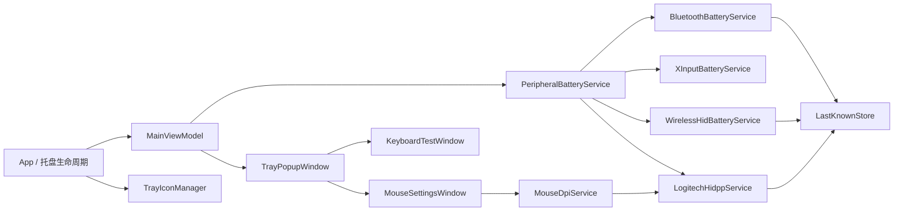
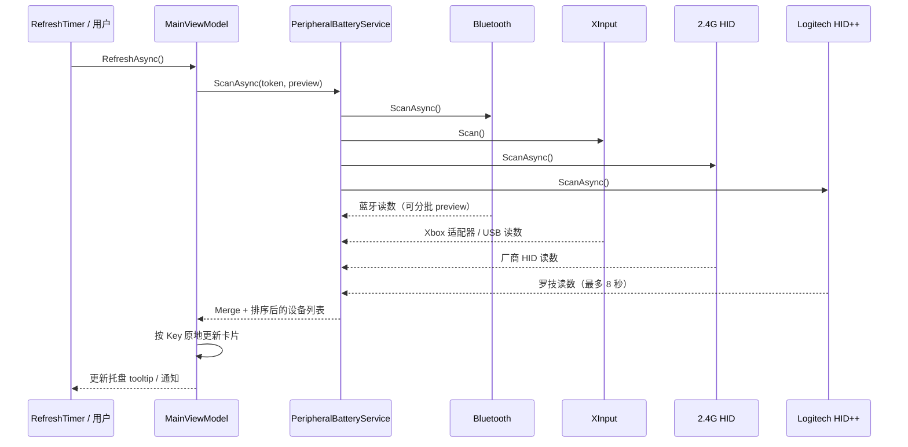

# 架构说明

BatteryDock（电量坞）是一个 Windows 托盘应用，负责把蓝牙、Windows 电量属性和多种 2.4 GHz HID 私有协议汇总成一份设备电量列表。项目刻意保持小而直接：没有后台服务、没有网络、没有厂商 SDK。

## 总览



运行时只有一个进程和一个托盘图标。所有设备读取都在本机完成。

## 目录与职责

| 路径 | 职责 |
|---|---|
| `App.xaml`, `App.xaml.cs` | 单实例、托盘生命周期、刷新计时器、主题、开机启动、低电量通知 |
| `TrayPopupWindow.xaml(.cs)` | 无边框液态玻璃面板、设置页、设备卡片点击路由、拖拽和定位 |
| `KeyboardTestWindow` | 104 键按键测试 |
| `MouseSettingsWindow` | DPI / 回报率编辑 |
| `ViewModels/MainViewModel.cs` | 设备列表、筛选、刷新状态、原地更新、精确/档位分组 |
| `ViewModels/SettingsViewModel.cs` | 设置绑定、主题/刷新/提醒/免打扰 |
| `Services/PeripheralBatteryService.cs` | 汇总蓝牙、XInput、2.4G 和罗技结果，合并同一设备 |
| `Services/BluetoothBatteryService.cs` | BLE GATT（含 3 次 Unreachable 重试）、Windows 属性和经典蓝牙 HFP |
| `Services/XInputBatteryService.cs` | 通过 `xinput1_4.dll` 读取 Xbox 适配器 / USB 手柄的 4 档电量 |
| `Services/WirelessHidBatteryService.cs` | 雷蛇、ATK/VXE、ROG Omni、MCHOSE、COMPX/HECHI/Nordic、DualSense USB、GameSir T4N2、BETOP |
| `Services/LogitechHidppService.cs` | HID++ 2.0 电量、稳定 ID、接收器通知、DPI/回报率 |
| `Services/MouseDpiService.cs` | 按设备品牌路由 DPI / 回报率操作 |
| `Services/LastKnownStore.cs` | 上次电量持久化，设备休眠时回退 |
| `Services/TrayIconManager.cs` | WinForms `NotifyIcon`、菜单、通知气泡 |
| `Services/ThemeManager.cs` | 深/浅色资源字典切换 |
| `Themes/*.xaml` | 颜色、玻璃材质、控件样式 |
| `Controls/*.cs` | 电池条、圆角裁剪面板 |

## 一次刷新发生了什么



几个重要行为：

- **预览合并**：蓝牙先返回时不会用空/局部结果清空面板，`MainViewModel.MergeReadings` 会保留当前卡片，等最终结果再替换。
- **原地更新**：`SyncDevices` 按设备 Key 更新现有 `DeviceItemViewModel`，不会先 `Clear()` 再重建列表。
- **超时隔离**：蓝牙最多等 15 秒；罗技扫描最多 8 秒；2.4G 厂商查询各自有短超时。一个协议卡住不会阻塞整个面板。
- **BLE 重试**：GATT 服务/特征发现或读取返回 `Unreachable` 时，释放当前 `BluetoothLEDevice` / `GattDeviceService`，等待 800ms 后重开，最多 3 次；`AccessDenied` 等确定性失败不重试。
- **XInput 去重**：Xbox 适配器 / USB 手柄通过 XInput 读取；蓝牙 Xbox 手柄也占用一个 XInput 槽位，因此按 `max(0, 无线槽位数 - 已连接蓝牙 Xbox 数)` 保留适配器条目，蓝牙精确百分比优先。预览阶段同样会做一次去重，避免同一台手柄短暂出现两张卡片。
- **上次电量**：读数失败时按稳定 Key 查 `last-known.json`；蓝牙键盘、鼠标、手柄默认保留上次电量。XInput 只存在于当前系统槽位，断开后不会生成离线卡片。
- **分组显示**：`MainViewModel.DevicesView` 使用 `PropertyGroupDescription` 按 `BatteryGroup` 分成“精确电量 / 档位电量 / 其他”；四档估算设备显示 `≈`。
- **重复提醒**：`App.ProcessLowBatteryAlerts` 在低电量未恢复时每 30 分钟再提醒一次；充电或电量回升超过阈值后重新武装。

## 线程模型

- WPF UI 在 Dispatcher 线程。
- 蓝牙、HID 扫描在线程池任务中运行。
- 扫描的 preview 回调可能来自工作线程；`MainViewModel` 捕获 `SynchronizationContext` 后 Post 回 UI 线程，避免跨线程修改 `ObservableCollection`。
- 罗技接收器监听器是独立后台任务，收到 `0x41` 通知后触发 debounce 刷新，再回到 UI 线程更新。
- 所有对 HID 的同步/异步读写都有超时；`HidNativeDevice` 的写入超时为 1 秒。

## 设备身份与合并

- 蓝牙：设备地址或 Windows 设备 ID 作为 Key。
- 罗技：优先 `0x0003 deviceInformation` 的序列号，其次 unit ID + model ID；失败时回退到型号 + 名称。
- 2.4G：VID/PID + 规范化名称；部分接收器使用槽位。
- XInput：`xinput:{slot}`；槽位号由系统分配，无法从公开 API 取得手柄序列号。
- `PeripheralBatteryService` 先按 Key 合并，再按规范化名称合并，优先在线/精确读数，避免蓝牙和 2.4G 重复展示；XInput 条目另按蓝牙 Xbox 数量去重。

## 持久化

```text
%LOCALAPPDATA%\BatteryDock\settings.json
%LOCALAPPDATA%\BatteryDock\last-known.json
%LOCALAPPDATA%\BatteryDock\app.log
```

- `settings.json`：主题、刷新频率、低电量阈值、免打扰、显示选项、开机启动状态。
- `last-known.json`：最多保留 100 条设备读数；包含 `Name`、`Battery`、`Estimated`、`Kind`、`ObservedAt`。
- `app.log`：`--verbose` 时记录协议来源、原始读数、超时和异常；默认仍记录关键生命周期事件。
- 写入使用临时文件 + 替换，避免设置文件写坏。

## UI 与主题

- 主窗口使用 `WindowStyle=None`、`AllowsTransparency=True`，以便做圆角透明玻璃壳。
- `RoundedClipPanel` 用 `RectangleGeometry` 把环境光场裁切到圆角内部；外层 Border 负责阴影和描边。
- 深/浅色资源字典提供 `WindowBackgroundBrush`、`GlassCardBrush`、`GlassCardBorderBrush`、`AccentGradientBrush` 等键，`ThemeManager.Apply` 在运行时替换字典，所有 `DynamicResource` 自动更新。
- 液态玻璃不是实时折射。WPF 没有浏览器 `backdrop-filter` 的等价物；这里用环境光场、渐变高光、内外阴影和多层透明来模拟，优先保证文字可读性。
- 键鼠工具窗口保留系统标题栏，便于缩放；内容区复用玻璃卡片和主题色。

## 安全与隐私

- 不联网、不上传、不启动子进程、不加载厂商 DLL。
- 只打开 HID 设备路径和 Windows 蓝牙属性，不需要管理员权限。
- 电量读取为只读；DPI/回报率写入只在用户点击“应用”时发生，不写固件。
- 日志可能包含设备名称、VID/PID、协议来源；提交 issue 前请检查是否包含隐私信息。
- 详见 [SECURITY.md](../SECURITY.md)。

## 已知边界

- 2.4G 私有协议因型号/固件而异，不能保证覆盖所有设备。
- XInput 只提供 4 档电量，显示为估算值；无法取得手柄身份，多个手柄同时在线时槽位归属可能不准确。
- DualSense 只解析 USB；GameSir 蓝牙模式 / 其他北通型号尚未验证；新协议首次接入时应先看 `--verbose` 日志中的原始帧。
- 设备休眠时通常不会返回新电量；应用会回退到上次电量。
- 部分雷蛇固件不开放 HID 回报率切换；UI 会明确提示。
- 罗技 HID++ 1.0 老设备暂未覆盖；稳定 ID/接收器通知需要在对应硬件上复测。
- WPF 透明窗口在远程桌面、部分显卡驱动或高对比度主题下可能表现不同。

## 相关文档

- [协议与验证矩阵](PROTOCOLS.md)
- [开发与调试](DEVELOPMENT.md)
- [发布流程](RELEASE.md)
- [第三方说明](../THIRD-PARTY-NOTICES.md)
